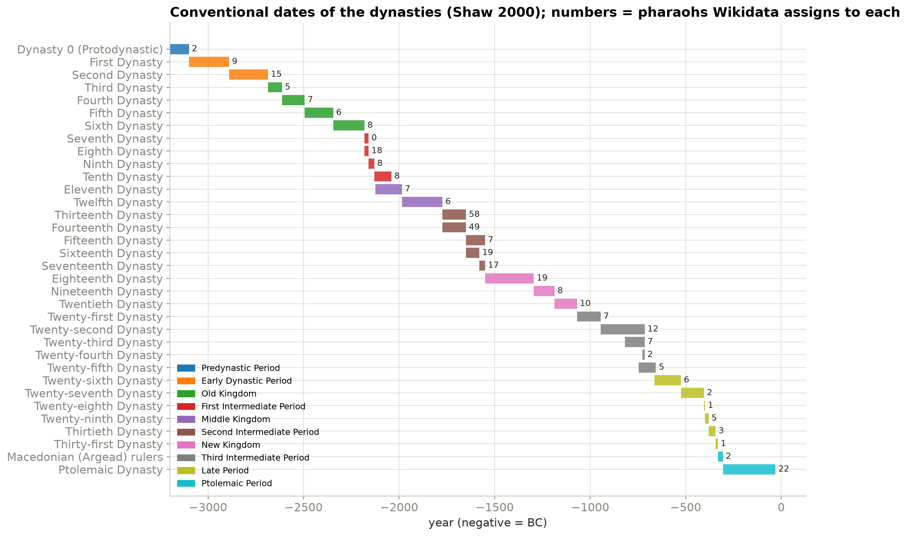
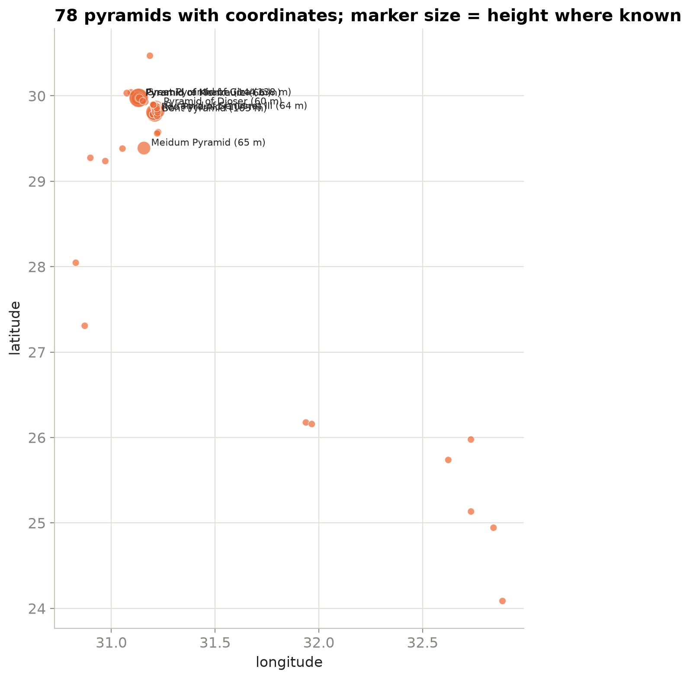

# Pharaohs of Egypt: a reproducible dataset of rulers, dynasties and pyramids

A small data-engineering pipeline that turns Wikidata into three clean, validated tables about ancient Egypt, with a hand-curated chronology where Wikidata is silent and a quality log for everything the pipeline refused. Built so the data can be re-pulled whenever Wikidata improves and so every row can be traced to its source query.

| Table | Rows | What it holds |
|---|---|---|
| `data/pharaohs.csv` | 513 rulers | name, Wikidata id, dynasty and period, reign start/end with the precision Wikidata records (year, decade, century), reign length, birth, death, sex, image and Wikipedia URLs |
| `data/dynasties.csv` | 38 dynasties | the conventional chronology (Shaw 2000) joined to Wikidata's own dates, period and predecessor |
| `data/pyramids.csv` | 84 pyramids | coordinates (78), height (17), the pharaoh it was built for, place, date |
| `data/quality_notes.csv` | 15 notes | dates the pipeline nulled (legendary "4001 BC" reigns and the like), with the reason |
| `data/validation_report.json` | | the pandera checks every table passed |



## The pipeline

```
pipeline/extract.py   three SPARQL queries against query.wikidata.org, one a minute (pharaohs, dynasties, pyramids)
                      -> data/raw/*.json + manifest.json (query text and retrieval time)
pipeline/build.py     raw rows -> tables: astronomical years to BC/AD labels, precision flags, one row per entity,
                      earliest reign start / latest end when Wikidata has several statements, dynasty numbers
                      parsed from labels, the conventional chronology joined, out-of-range dates nulled and logged
pipeline/validate.py  pandera schemas: unique ids, years inside 3300 BC – AD 400, reigns that end after they
                      start, coordinates inside Egypt, positive heights, URLs that look like URLs
make_notebook.py      writes explore.ipynb, which draws the three figures
```

```bash
pip install -r requirements.txt
python pipeline/extract.py      # ~3 minutes because of the rate limit
python pipeline/build.py        # builds the tables and runs the validation
python make_notebook.py && jupyter nbconvert --to notebook --execute --inplace explore.ipynb
```

## Dates

Wikidata stores years in astronomical numbering (year 0 exists), so its `-1549` is 1550 BC. The `*_year` columns keep the signed astronomical year, which sorts and subtracts correctly; the `*_label` columns say "1550 BC". The `*_precision` columns matter: a reign known to the century is not a reign known to the year.

The dynasty chronology is the conventional one (Shaw, I., ed., *The Oxford History of Ancient Egypt*, 2000, as summarised in Wikipedia's list of pharaohs). It is one scheme among several, and absolute dates before the New Kingdom carry decades of uncertainty; the file says so in its `note` column.

## What the data can and cannot say

- Wikidata assigns a dynasty to 384 of the 513 pharaohs and has reign dates for 76. The Second Intermediate Period alone contributes 150 names, mostly kings known from a single scarab or king-list entry.
- 302 pharaohs have an image on Wikimedia Commons, which makes the table usable for a gallery or a quiz.
- Pyramid heights are thin (17 of 84); the literature has them, Wikidata does not yet.



## Licence

Code: MIT. Data from Wikidata is CC0; the curated chronology table and the derived tables are released under CC BY 4.0, attribution "Omar Essam El Sherbiny, pharaohs-of-egypt". Images are linked, not copied; each has its own licence on Wikimedia Commons.

Also published as a [Kaggle dataset](https://www.kaggle.com/datasets/engomaressam/pharaohs-of-egypt) and a [Hugging Face dataset](https://huggingface.co/datasets/omaressamrme/pharaohs-of-egypt).

## Author

Omar Essam El Sherbiny: [website](https://omaressam.web.app) · [LinkedIn](https://www.linkedin.com/in/omar-essam-el-sherbiny-b602279b/)
